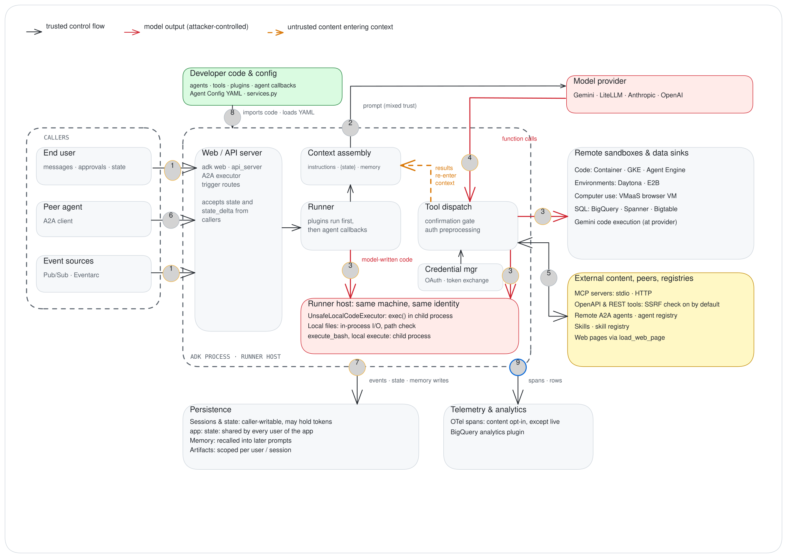

# Security Policy

## Reporting a vulnerability

Please use https://g.co/vulnz to report security vulnerabilities.

We use https://g.co/vulnz for our intake and triage. For valid issues we will do coordination and disclosure here on GitHub (including using a GitHub Security Advisory when necessary).

The Google Security Team will process your report within a day, and respond within a week (although it will depend on the severity of your report).

## ADK threat model

### Trust boundaries

The numbers match the markers in the diagram.

1. Callers to the ADK server
2. Untrusted data into the prompt
3. Model output to privileged sinks
4. Human approval
5. Tools, MCP servers, skills, APIs
6. Agent to agent and registries
7. Persistence and tenancy
8. Code, config and plugins
9. Telemetry and analytics export

## Scope

### Core (fully supported)

The following surfaces are all in scope for vulnerability reports, fixes, and published advisories:

- **Core runtime:** Runner, Flows, Event system, LLM abstraction layer (Gemini, Claude, LiteLLM, etc.)
- **Agent orchestration:** LlmAgent, Workflow (DAG-based), deprecated Sequential/Parallel/Loop agents, Planners, agent transfer/delegation
- **Tools & capabilities:** Built-in tools, toolset types (FunctionTool, MCPToolset, OpenAPIToolset, BigQueryToolset, ComputerUseTool, etc.), code execution backends
- **State & persistence:** Session services (InMemory, Database/SQLAlchemy, SQLite, VertexAI), Memory services (InMemory, VertexAI MemoryBank, VertexAI RAG), Artifact services (InMemory, File, GCS)
- **Authentication & credentials:** OAuth2+PKCE, Client Credentials, Service Account, API Key flows
- **Integration protocols:** MCP (Model Context Protocol) client, A2A (Agent-to-Agent) protocol (both server and client)
- **Application surfaces:** CLI (`adk web`, `adk run`, `adk deploy`, etc.), FastAPI-based Dev UI and API server, Agent Builder assistant, Evaluation framework
- **Deployment targets:** Local development, Cloud Run, GKE, Vertex AI Agent Engine
- **Telemetry:** OpenTelemetry traces/metrics/logs with the built-in counters
- **Plugin/Skills interfaces:** Plugins and skills integration points used to write reusable units on top of ADK that can get composed into other agents
- **Built-in 1P plugins/integrations:** BigQuery, Cloud Run, Model Armor, etc.

### Bundled integrations (best effort)

We aim to reactively harden the other pieces that are shipped as part of the ADK package, but might need assistance from the respective experts/contributors.

- **Bundled 3P integrations:** Daytona, E2B, Slack, etc. integrations, and LangChain/CrewAI adapters
- **Unofficial 3P integrations/plugins:** Though the plugin interface is hardened, the contents of 3P plugins and their sourcing are left to the discretion of their respective owners

### Out of scope / not a vulnerability

#### Trust model

- The developer's code, YAML, plugins and environment are trusted.
- User input, model output, tool, MCP and A2A results, and session state written by clients are untrusted.
- Everything in the ADK process runs as one identity, so local executors and bash don't isolate anything.
- `api_server` and `adk web` don't authenticate callers.

#### Not a vulnerability

- A prompt injection that succeeds but doesn't get around any ADK protection. For example, the model calls a tool that the developer exposed without requiring confirmation.
- Code running through components with "unsafe" or "local" in the name: `UnsafeLocalCodeExecutor`, `LocalEnvironment`, `bash_tool` with no policy.
- Exposing `adk web` or `api_server` to untrusted networks without an auth proxy, including quota abuse through an open `/run`.
- Malicious agent code, YAML or plugins supplied by the operator.
- Bugs in third-party MCP servers, A2A peers, model providers, or community plugins (google-adk-community). Report those upstream.
- Dependency CVEs that ADK can't actually trigger. Report those upstream too.
- Model hallucinations or harmful content, unless an ADK safety integration (such as Model Armor) fails to act on content it claims to screen.
- Sample agents under `contributing/samples/`, unless the sample is presented as production-ready.

## Third-party dependencies

ADK declares version ranges, not exact pins, so installs pick up new compatible releases. For reproducible installs we publish `constraints-3.{11,12,13,14,15}.txt`, which are fully pinned. They only include releases that were at least 4 days old when the files were generated, which gives some protection against compromised releases. We recommend `pip install google-adk -c constraints-3.x.txt`.

When a dependency has a vulnerability ADK can trigger, we raise the minimum version or exclude the affected releases, and we note it in the changelog. Report vulnerabilities in a dependency itself to that project.

## Best practices for hardening your deployment

- Make sure the API server is not exposed to the internet.
- Put an auth proxy in front if required.
- Bind to 127.0.0.1 where possible to avoid any unexpected leaks.
- Use container, GKE or Agent Engine executors instead of the local ones.
- Turn on tool confirmation for write and destructive tools.
- Consider using the `ToolCallIntegrityPlugin` to get better TOCTOU posture on tool confirmations.
- Use the Model Armor plugin.
- Set a Cloud KMS key (`kms_key_name` or `GOOGLE_CREDENTIAL_KMS_KEY`) to encrypt the credentials that the Google Cloud toolsets (BigQuery, GCS, Spanner, Bigtable, Pub/Sub, etc.) cache in session state.
- Keep static secrets such as API keys and OAuth client secrets in Secret Manager rather than in code or config.
- Avoid `SessionStateCredentialService` when clients can reach the session APIs; it stores end-user access and refresh tokens in plain text in session state.
- Set `ADK_CAPTURE_MESSAGE_CONTENT_IN_SPANS=false` to keep prompt and response content off trace spans. It defaults to on for live streaming spans and for the legacy telemetry schema (`ADK_TELEMETRY_SCHEMA_VERSION_OPT_IN=1`).
- Install ADK via the constraints files when possible.
- Keep BigQuery writes blocked (the default) unless you need them.
- Do not store sensitive information in session state, since clients can read and write the session store through the exposed APIs.
