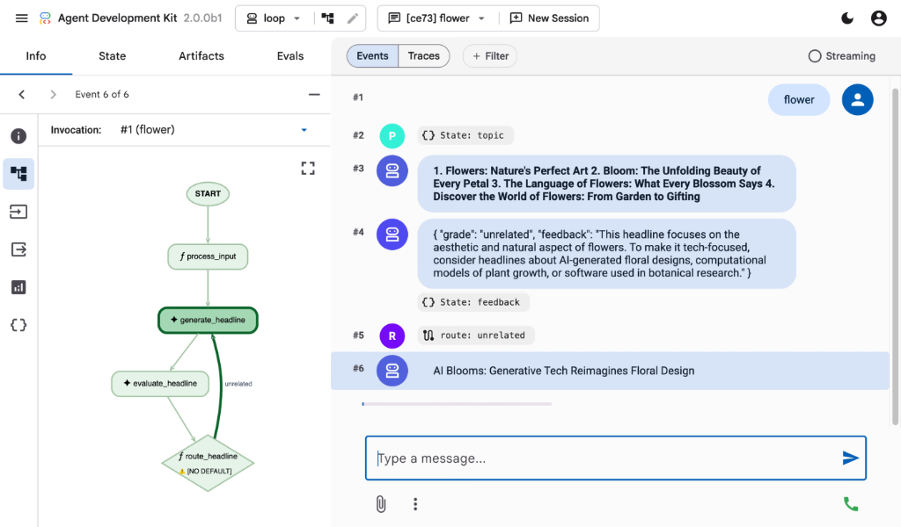

# Agent Development Kit (ADK) 2.0

[](LICENSE)
[](https://pypi.org/project/google-adk/)
[](https://pypi.org/project/google-adk/)
[](https://pepy.tech/project/google-adk)
[](https://github.com/google/adk-python/actions/workflows/continuous-integration.yml)
[](https://adk.dev/)
[](https://www.reddit.com/r/agentdevelopmentkit/)
<a href="https://codewiki.google/github.com/google/adk-python"></a>

<h2 align="center">
  
</h2>
<h3 align="center">
  一个开源、代码优先（Code-First）的 Python 框架，助力灵活、可控地构建、评测与部署复杂 AI 智能体（Agents）。
</h3>
<h3 align="center">
  重要链接：
  <a href="https://adk.dev/">官方文档</a>、
  <a href="https://github.com/google/adk-recipes">示例代码</a> 与
  <a href="https://github.com/google/adk-web">ADK Web</a>。
</h3>
<h3 align="center">
  其他语言版本的 ADK：
  <a href="https://github.com/google/adk-java">ADK Java</a>、
  <a href="https://github.com/google/adk-kotlin">ADK Kotlin</a>、
  <a href="https://github.com/google/adk-go">ADK Go</a> 与
  <a href="https://github.com/google/adk-js">ADK Typescript</a>。
</h3>
<p align="center">
  <a href="README.md">English</a> · <b>简体中文</b>
</p>

Agent Development Kit (ADK) 是一个灵活且模块化的框架，将软件工程原则引入 AI 智能体的创建过程中。它旨在简化从简单任务到复杂多智能体系统的构建、部署与工作流编排。尽管针对 Gemini 进行了深度优化，但 ADK 具备模型无关性（Model-Agnostic）与部署环境无关性（Deployment-Agnostic），并可与其他主流框架无缝兼容。

## ✨ 核心特性

- **工作流运行时 (Workflow Runtime)**：基于图的执行引擎，用于为智能体应用编排确定性执行流，原生支持条件路由（Routing）、扇出/扇入（Fan-out/Fan-in）、循环、重试机制、状态管理、动态节点、人机回环（Human-in-the-loop）以及嵌套工作流。

- **任务接口 (Task API)**：结构化的智能体间任务委派机制，支持多轮任务模式、单轮受控输出、混合委派模式、人机回环，并支持将任务智能体直接作为工作流节点。

- **模块化多智能体系统 (Modular Multi-Agent Systems)**：通过将多个专业领域的智能体组合为灵活的层级架构，设计具备高可扩展性的应用程序。

- **丰富的工具生态 (Rich Tool Ecosystem)**：支持使用预置工具、自定义函数、OpenAPI 规范、MCP 工具或集成现有工具，赋予智能体多样化能力，并与 Google 生态紧密融合。

- **代码优先开发 (Code-First Development)**：直接在 Python 中定义智能体逻辑、工具与编排流程，实现极致的灵活性、可测试性与版本控制能力。

- **智能体配置 (Agent Config)**：无需编写代码即可构建智能体，详情请参阅 [Agent Config](https://adk.dev/agents/config/) 功能说明。

- **工具执行确认 (Tool Confirmation)**：提供[工具确认工作流 (HITL)](https://adk.dev/tools-custom/confirmation/)，可通过显式确认与自定义输入对工具执行进行安全守护。

- **随处部署 (Deploy Anywhere)**：轻松将智能体容器化并部署至 Cloud Run，或借助 Gemini Enterprise Agent Platform（原 Vertex AI Agent Engine）上的 Agent Runtime 实现无缝弹性扩展。

## 🚀 安装指南

### 稳定版本（推荐）

您可以使用 `pip` 安装最新稳定版本的 ADK：

```bash
pip install google-adk
```

**环境要求：** Python 3.11+。

为了确保传递依赖的稳定性，我们建议配合官方提供的配套 `constraints` 约束文件进行安装（支持 Python 3.11 至 3.15）。

请选择与您的 Python 版本相匹配的约束文件：

```bash
# 例如，针对 Python 3.11
curl -o constraints-3.11.txt https://raw.githubusercontent.com/google/adk-python/main/constraints-3.11.txt
pip install google-adk -c constraints-3.11.txt
rm constraints-3.11.txt
```

如需安装可选扩展集成，可使用以下命令：

```bash
pip install "google-adk[extensions]"
```

稳定版本的发布周期大约为每两周一次。

### 开发版本 (Development Version)

错误修复与新功能会优先合入 GitHub 的 `main` 分支。如果您需要使用尚未包含在正式 PyPI 发布版中的最新改动，可以直接从 `main` 分支安装：

```bash
pip install git+https://github.com/google/adk-python.git@main
```

注意：开发版本直接基于最新代码提交构建。虽然包含最新的修复与特性，但也可能包含尚未经过完整发布的实验性改动或潜在缺陷。建议仅在测试即将发布的功能或急需获取关键修复时使用。

## 快速开始

> **新手提示：** ADK 应用主要通过两个核心类构建：
> **`Agent`**（定义 AI 的指令、工具与行为）以及
> **`Workflow`**（在基于图的流程中编排多个智能体与任务）。

### Agent

```python
from google.adk import Agent

root_agent = Agent(
    name="greeting_agent",
    model="gemini-3.5-flash",
    instruction="You are a helpful assistant. Greet the user warmly.",
)
```

### Workflow

```python
from google.adk import Agent, Workflow

generate_fruit_agent = Agent(
    name="generate_fruit_agent",
    instruction="Return the name of a random fruit. Return only the name.",
)

generate_benefit_agent = Agent(
    name="generate_benefit_agent",
    instruction="Tell me a health benefit about the specified fruit.",
)

root_agent = Workflow(
    name="root_agent",
    edges=[("START", generate_fruit_agent, generate_benefit_agent)],
)
```

### 本地运行

```bash
# 交互式命令行 (Interactive CLI)
adk run path/to/my_agent

# Web 界面（支持多智能体目录或直接指向单个智能体文件夹）
adk web path/to/agents_dir
```

### 开发调试界面 (Development UI)

内置可视化开发调试界面，帮助您测试、评测、调试并展示智能体运行效果。

[](https://youtu.be/TEjqk0eeNy8)

[](https://youtu.be/TEjqk0eeNy8)

### 评测智能体 (Evaluate Agents)

在仓库根目录下运行内置的评测示例：

```bash
adk eval \
    contributing/samples/evaluation/home_automation_agent \
    contributing/samples/evaluation/basic_criteria/home_automation.evalset.json \
    --config_file_path contributing/samples/evaluation/basic_criteria/eval_config.json
```

### 🚀 部署选项

使用 Docker 容器在本地部署智能体：

```bash
adk deploy docker --with_ui <agent-folder>
```

在 Google Cloud (Cloud Run) 上部署智能体：

```bash
adk deploy cloud_run --with_ui <agent-folder>
```

您也可以在 `adk` 命令中直接指定以下环境变量，或将其配置在 `.env` 文件中：

```bash
adk deploy cloud_run --with_ui --env GOOGLE_GENAI_USE_ENTERPRISE=1 <agent-folder>
```

## 📚 文档资源

- **快速入门**：https://adk.dev/
- **专题指南 (Guides)**：参阅
  [`docs/guides/`](https://github.com/google/adk-python/tree/main/docs/guides)，获取面向具体任务的智能体、工具、事件、插件及工作流实战指南。
- **代码示例 (Samples)**：参阅
  [`contributing/samples/`](https://github.com/google/adk-python/tree/main/contributing/samples)，获取可直接运行的智能体示例。

## 🤝 参与贡献

我们非常欢迎来自社区的贡献！无论是提交缺陷报告、功能需求、文档改进还是代码贡献，请先查阅：

- [通用贡献指南与流程](https://adk.dev/community/contributing-guide/)。
- [代码贡献准则](./CONTRIBUTING.md) 以快速上手。

## 社区扩展仓库 (Community Repo)

我们提供了 [adk-python-community 仓库](https://github.com/google/adk-python-community)，汇聚了不断壮大的社区贡献工具、第三方服务集成及部署脚本，用于扩展 ADK 的核心能力。

## Vibe Coding（氛围编程）

如果您希望通过 Vibe Coding 方式开发智能体，可以使用发布在 ADK 文档网站上的 [llms.txt](https://adk.dev/llms.txt) 和 [llms-full.txt](https://adk.dev/llms-full.txt) 文件作为大语言模型的上下文。前者为精简摘要版，后者则包含面向长上下文窗口模型的全量文档内容。

## 社区活动

- [已结束] ADK 首届社区会议已于 2025 年 10 月 15 日（周三）举行。欢迎[加入社区讨论组](https://groups.google.com/g/adk-community)以获取[会议录像](https://drive.google.com/file/d/1rpXDq5NSH8-MyMeYI6_5pZ3Lhn0X9BQf/view)及[演示文稿](https://docs.google.com/presentation/d/1_b8LG4xaiadbUUDzyNiapSFyxanc9ZgFdw7JQ6zmZ9Q/edit?slide=id.g384e60cdaca_0_658&resourcekey=0-tjFFv0VBQhpXBPCkZr0NOg#slide=id.g384e60cdaca_0_658)。

## 📄 许可证

本项目基于 Apache 2.0 许可证开源 —— 详情请参阅 [LICENSE](LICENSE) 文件。

______________________________________________________________________

*祝您构建智能体愉快！*

---

> **免责声明**：本文档由社区志愿者维护与翻译。如翻译内容与英文原文存在出入，请以英文原版为准。
