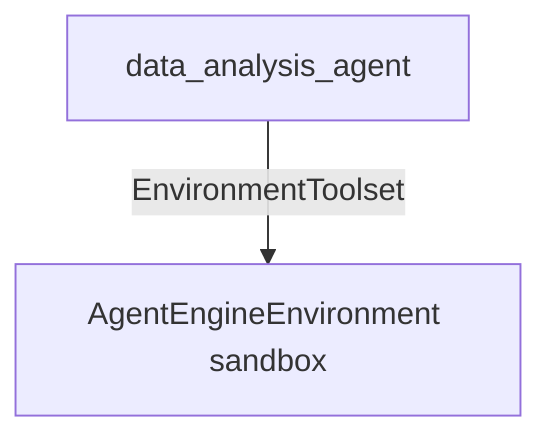

# Agent Engine Environment Sample

## Overview

A small data analysis agent that uses `AgentEngineEnvironment` with the
`EnvironmentToolset` to write and run Python inside an Agent Engine sandbox, a
gVisor-isolated container in your Google Cloud project with a persistent
filesystem.

Asked a question, the agent writes a short script, runs it in the sandbox, and
reports the result, without touching the user's machine. Files stay in the
sandbox between turns, so later turns build on data and scripts from earlier
ones. The default shell sandbox has Python 3 with only the standard library and
no internet access.

The sandbox is created on the agent's first turn. When the toolset closes, for
example when the server shuts down, the sandbox is paused rather than deleted,
and it resumes with its files the next time it is used.

## Prerequisites

1. Install the `gcp` extra:

   ```bash
   pip install google-adk[gcp]
   ```

1. Set up Application Default Credentials for a project with the Vertex AI API
   enabled, and point the sample, and Gemini on Vertex AI, at it:

   ```bash
   gcloud auth application-default login
   export GOOGLE_CLOUD_PROJECT="my-project"
   export GOOGLE_CLOUD_LOCATION="global"
   export GOOGLE_GENAI_USE_VERTEXAI=TRUE
   ```

1. Optionally, reuse an agent engine so later runs skip creating the sandbox
   template, which can take several minutes the first time:

   ```bash
   export AGENT_ENGINE_NAME="projects/my-project/locations/us-central1/reasoningEngines/1234"
   ```

   `AGENT_ENGINE_LOCATION` sets the location of the sandbox and defaults to
   `us-central1`.

## Sample Inputs

- `Write a python script that generates 10k rows of fake sales data, save it as sales.csv, then summarize it.`

  The agent writes a generator script, runs it, and then summarizes
  `sales.csv`, for example total revenue and the top regions or products.

- `Which month had the highest revenue in sales.csv?`

  A follow-up to the previous turn. The agent reuses `sales.csv` from the
  sandbox instead of generating it again.

- `List the files in your workspace and their sizes.`

  Shows the files the earlier turns left in the sandbox.

## Graph



## How To

The agent is a standalone `Agent` wired to one `EnvironmentToolset` whose
`environment` is an `AgentEngineEnvironment`:

```python
from google.adk.integrations.vmaas import AgentEngineEnvironment
from google.adk.tools.environment import EnvironmentToolset

EnvironmentToolset(
    environment=AgentEngineEnvironment(
        project_id="my-project",
        location="us-central1",
        agent_engine_name=(
            "projects/my-project/locations/us-central1/reasoningEngines/1234"
        ),
    ),
)
```

- `agent_engine_name` is the agent engine the sandbox template and sandbox are
  created under. If it is not set, one is created on first use.
- `sandbox_name` attaches to an existing sandbox instead of creating one. The
  sample reads it from `AGENT_ENGINE_SANDBOX_NAME`, so after restarting the
  server you can continue in the sandbox an earlier run created, whose name
  appears in the log line `Created sandbox: ...`.

## Related Guides

- [AgentEngineEnvironment](../../../../docs/guides/integrations/vmaas/agent_engine_environment/index.md) - Explains the sandbox lifecycle, configuration options, and limitations.
