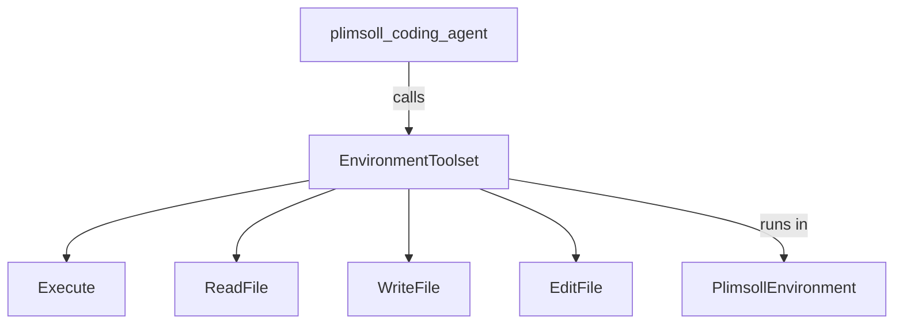

# Plimsoll Environment Sample

## Overview

This sample uses `PlimsollEnvironment` with `EnvironmentToolset` so an ADK
agent can execute commands and edit files in a sandbox you run yourself. The
environment opens one Plimsoll session, a sandbox kept for many calls, when the
agent first runs, and closes it, with its files, when the toolset closes.

Plimsoll states the isolation tier each sandbox runs behind (`container`,
`kernel` or `vm`), and the environment refuses to open one below the
`minimum_isolation` you set. This sample asks for `kernel`, which a Docker
daemon running gVisor meets and plain Docker does not. The sandbox has no
network access. See the
[Plimsoll repository](https://github.com/plimsollmark/plimsoll) for the
daemon and its providers.

## Prerequisites

1. Install the Plimsoll extra:

   ```bash
   pip install google-adk[plimsoll]
   ```

1. Start a Plimsoll daemon with sessions enabled. From a Plimsoll checkout,
   after `make docker-images`, with Docker's `runsc` runtime installed:

   ```bash
   export PLIMSOLL_TOKEN=$(openssl rand -hex 16)
   SANDBOX_PROVIDER=docker SANDBOX_DOCKER_RUNTIME=runsc \
     SANDBOX_DOCKER_PROJECT_IMAGE=plimsoll/sandbox-python \
     SANDBOX_MAX_SESSIONS=4 PLIMSOLL_ADDR=127.0.0.1:8746 \
     go run ./cmd/plimsolld
   ```

1. In the shell that runs the agent, point it at the daemon:

   ```bash
   export PLIMSOLL_URL="http://127.0.0.1:8746"
   export PLIMSOLL_TOKEN="<the same token>"
   ```

1. Configure the model credentials required by your ADK setup.

## Sample Inputs

- `Write a Python script that prints the first 20 Fibonacci numbers, run it, and report the output.`
- `Create a binary file containing bytes 0 through 255, then verify its size and SHA-256 digest.`
- `Create a small CSV of five products and write a Python script that reports the most expensive one.`

## Graph



## How To

The agent is connected to a normal `EnvironmentToolset`:

```python
from google.adk.integrations.plimsoll import PlimsollEnvironment
from google.adk.tools.environment import EnvironmentToolset

toolset = EnvironmentToolset(
    environment=PlimsollEnvironment(minimum_isolation="kernel")
)
```

Relative paths resolve below the sandbox's working directory (`/work` on
Docker). Each command runs in a new `sh`, so files persist between commands and
a `cd` or an `export` does not. For your own code on your own machine, plain
Docker states the `container` tier; pass `minimum_isolation="container"` to
accept it.
