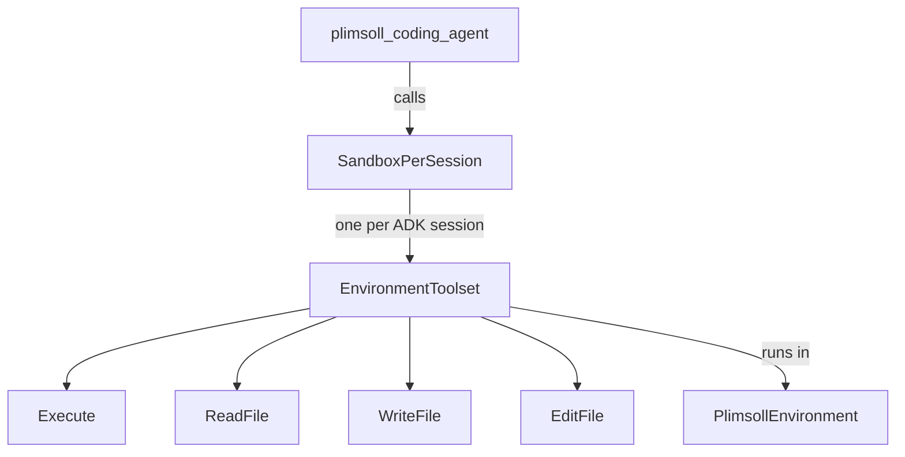

# Plimsoll Environment Sample

## Overview

This sample uses `PlimsollEnvironment` with `EnvironmentToolset` so an ADK
agent can execute commands and edit files in a sandbox you run yourself. Each
ADK session gets an environment of its own, and with it one Plimsoll session, a
sandbox kept for many calls, opened on the session's first tool call. The
sandbox and its files are closed when a Runner that holds the agent closes.

Plimsoll states the isolation tier each sandbox runs behind (`container`,
`kernel` or `vm`), and the environment refuses to open one below the
`minimum_isolation` you set. This sample asks for `kernel`, which a Docker
daemon running gVisor meets and plain Docker does not. The sandbox has no
network access. See the
[Plimsoll repository](https://github.com/plimsollmark/plimsoll) for the
daemon and its providers.

## Prerequisites

1. Install the Plimsoll extra:

   ```bash
   pip install google-adk[plimsoll]
   ```

1. Start a Plimsoll daemon with sessions enabled. From a Plimsoll checkout,
   after `make docker-images`, with Docker's `runsc` runtime installed:

   ```bash
   export PLIMSOLL_TOKEN=$(openssl rand -hex 16)
   SANDBOX_PROVIDER=docker SANDBOX_DOCKER_RUNTIME=runsc \
     SANDBOX_DOCKER_PROJECT_IMAGE=plimsoll/sandbox-python \
     SANDBOX_MAX_SESSIONS=4 PLIMSOLL_ADDR=127.0.0.1:8746 \
     go run ./cmd/plimsolld
   ```

1. In the shell that runs the agent, point it at the daemon:

   ```bash
   export PLIMSOLL_URL="http://127.0.0.1:8746"
   export PLIMSOLL_TOKEN="<the same token>"
   ```

1. Configure the model credentials required by your ADK setup.

## Sample Inputs

- `Write a Python script that prints the first 20 Fibonacci numbers, run it, and report the output.`
- `Create a binary file containing bytes 0 through 255, then verify its size and SHA-256 digest.`
- `Create a small CSV of five products and write a Python script that reports the most expensive one.`

## Graph



## How To

For one Runner, such as `adk run` or the chat of `adk web`, an
`EnvironmentToolset` with one environment is enough:

```python
from google.adk.integrations.plimsoll import PlimsollEnvironment
from google.adk.tools.environment import EnvironmentToolset

toolset = EnvironmentToolset(
    environment=PlimsollEnvironment(minimum_isolation="kernel")
)
```

That environment holds one sandbox for every agent run that uses it. ADK
closes it when a Runner that holds the agent closes, and a closed
`PlimsollEnvironment` raises `RuntimeError` instead of opening a new, empty
sandbox the agent would take for the one holding its files. `adk eval` runs
each eval case in a Runner of its own, up to four at once, over the same agent,
so with one environment the first case to end closes it and the next case
raises. The sample's `SandboxPerSession` toolset therefore keeps an
`EnvironmentToolset` and a `PlimsollEnvironment` for each ADK session, marks a
session as running from `before_agent_callback` to `after_agent_callback`, and
closes only the sandboxes of sessions that are not running. Two limits of this
approach:

- A run that raises skips `after_agent_callback`, so its sandbox stays open
  until the daemon ends the session (`SANDBOX_SESSION_LIFETIME`, 30 minutes by
  default).
- The Eval tab of `adk web` runs its cases over the agent the chat uses, and
  each case's Runner closes the sandboxes of chat sessions between turns. The
  chat's next tool call then raises `RuntimeError`; start a new session.

Each session's sandbox holds one of the daemon's places until it is closed, so
`SANDBOX_MAX_SESSIONS` bounds how many ADK sessions can have a sandbox at once;
`adk eval` at its default parallelism needs four.

Relative paths resolve below the sandbox's working directory (`/work` on
Docker). Each command runs in a new `sh`, so files persist between commands and
a `cd` or an `export` does not. The `Execute` tool gives each command 30
seconds, capped at the daemon's own limit. If a call is cut while in flight
(ADK cancels the other calls of a parallel batch when one of them fails), that
session's sandbox is lost: the environment closes it, and every later call of
that session raises `RuntimeError` saying the sandbox was lost; start a new
session. For your own code on your own machine, plain Docker states the
`container` tier; pass `minimum_isolation="container"` to accept it.
