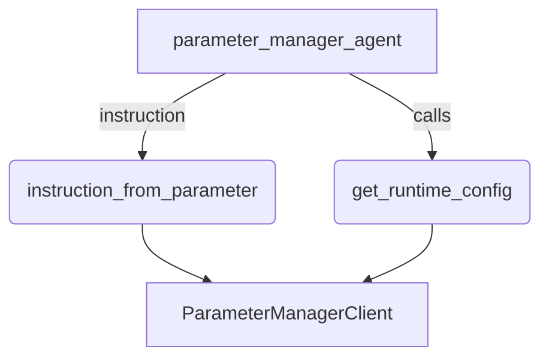

# Parameter Manager Sample

## Overview

This sample agent demonstrates `ParameterManagerClient` from the
`google.adk.integrations.parameter_manager` module. Parameter Manager holds
non-secret runtime configuration, versioned and rendered server-side, so the
sample uses it for two things an operator wants to change without redeploying
the agent:

- The agent's **instruction**, loaded through an `InstructionProvider`. ADK
  resolves the provider on every LLM request (including after each tool call),
  so the sample caches the rendered parameter for 30 seconds; publishing a new
  parameter version changes the agent's behavior within that window.
- A JSON **runtime configuration** (feature flags, supported regions,
  escalation contacts) that the agent reads through the `get_runtime_config`
  tool.

If the instruction parameter cannot be read, the agent keeps the last
instruction it loaded, or falls back to a built-in instruction if none has
loaded yet.

## Sample Inputs

- `What regions do you support?`

  *The agent calls `get_runtime_config` with `key="supported_regions"`.*

- `Show me your full runtime configuration`

  *The agent calls `get_runtime_config` with no key and summarizes the JSON
  object.*

- `Who do I escalate a billing problem to?`

  *The agent reads `escalation_contacts` from the configuration.*

## Graph



## How To

### Prerequisites

1. Install the GCP extra, which provides `google-cloud-parametermanager`:

   ```bash
   pip install "google-adk[gcp]"
   ```

1. Enable the API and create the two parameters the sample expects. The
   configuration parameter uses the `JSON` format so Parameter Manager validates
   it on write:

   ```bash
   gcloud services enable parametermanager.googleapis.com

   gcloud parametermanager parameters create adk-sample-instruction \
       --location=global
   gcloud parametermanager parameters versions create v1 \
       --parameter=adk-sample-instruction --location=global \
       --payload-data='You are a support assistant for Example Corp. Be concise, and use the get_runtime_config tool whenever a question depends on supported regions, feature flags or escalation contacts.'

   gcloud parametermanager parameters create adk-sample-config \
       --location=global --parameter-format=JSON
   gcloud parametermanager parameters versions create v1 \
       --parameter=adk-sample-config --location=global \
       --payload-data='{"supported_regions": ["europe-north1", "europe-west1"], "feature_flags": {"refunds": true, "chat_handoff": false}, "escalation_contacts": {"billing": "billing-oncall@example.com"}}'
   ```

1. Make sure the identity the agent runs as has
   `roles/parametermanager.parameterViewer` on the parameters (or the project).

> **Keep secrets out of both parameters.** Parameter Manager can render Secret
> Manager references (`__REF__(...)`) into a parameter. Because `get_parameter`
> returns the rendered payload, a reference in `adk-sample-instruction` puts
> the plaintext secret into the system prompt, and one in `adk-sample-config`
> puts it into the tool response and session history. Do not use `__REF__(...)`
> with this sample; see the [Secret Manager sample](../secret_manager/README.md)
> for how to use secrets from a tool without exposing them.

### Configure credentials and the LLM

Set up `.env` for the LLM service, for example with Vertex AI so that one set
of Application Default Credentials serves both the model and the tools:

- `GOOGLE_GENAI_USE_ENTERPRISE=TRUE`
- `GOOGLE_CLOUD_PROJECT={your-project-id}`
- `GOOGLE_CLOUD_LOCATION={your-region}`

Then run `gcloud auth application-default login`. `ParameterManagerClient`
falls back to Application Default Credentials when neither
`service_account_json` nor `auth_token` is passed. If `GOOGLE_CLOUD_PROJECT`
is unset the sample uses the project attached to those credentials.

Optional environment variables:

- `PARAMETER_MANAGER_LOCATION` - parameter location, default `global`. For a
  regional location the client switches to the regional endpoint.
- `ADK_INSTRUCTION_PARAMETER_ID` / `ADK_CONFIG_PARAMETER_ID` - override the
  parameter IDs.

### Run

```bash
adk web contributing/samples/integrations
```

and pick `parameter_manager`.

## Related Guides

- [FunctionTool](../../../../docs/guides/tools/function_tool/index.md) - How plain Python functions become tools, including how docstrings and type hints shape the declaration the model sees.
- [LlmAgent](../../../../docs/guides/agents/llm_agent/index.md) - Agent configuration, including `instruction` as a string or an `InstructionProvider` callable.
