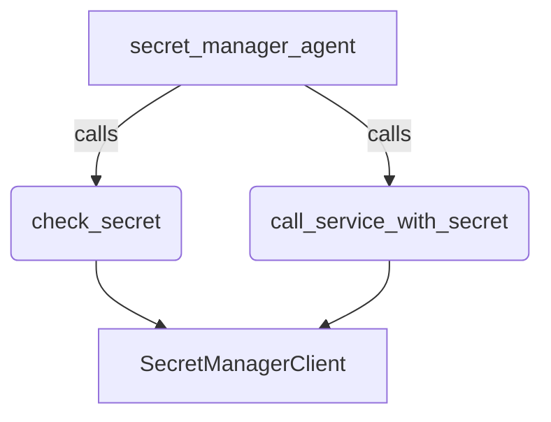

# Secret Manager Sample

## Overview

This sample agent demonstrates `SecretManagerClient` from the
`google.adk.integrations.secret_manager` module. It shows how to use secrets
from tools without exposing secret material to the model or allowing prompt
injection to exfiltrate credentials:

- `check_secret` verifies that an allowlisted secret is readable and returns
  only the resource name and status.
- `call_service_with_secret` looks up a named service in a server-side registry
  (`_SERVICES`) that pairs each secret ID with a fixed destination URL, so the
  model cannot send a credential to an arbitrary URL.

## Sample Inputs

- `Can you read the secret my-api-key?`

  *The agent calls `check_secret` and reports the resource name and status,
  never the secret value.*

- `Call the partner-health service`

  *The agent calls `call_service_with_secret(service_name="partner-health")`
  and relays the dry-run placeholder status.*

## Graph



## How To

### Prerequisites

1. Install the GCP extra, which provides `google-cloud-secret-manager`:

   ```bash
   pip install "google-adk[gcp]"
   ```

1. Enable the API and create the two sample secrets:

   ```bash
   gcloud services enable secretmanager.googleapis.com
   printf 'example-value' | gcloud secrets create my-api-key --data-file=-
   printf 'partner-secret' | gcloud secrets create partner-token --data-file=-
   ```

1. Grant `roles/secretmanager.secretAccessor` on each specific secret the agent
   needs (rather than at the project level) so the agent identity can only read
   intended secrets:

   ```bash
   for secret in my-api-key partner-token; do
     gcloud secrets add-iam-policy-binding "$secret" \
         --member="user:{your-email}" \
         --role="roles/secretmanager.secretAccessor"
   done
   ```

### Configure credentials and the LLM

Set up `.env` for the LLM service, for example with Vertex AI so that one set
of Application Default Credentials serves both the model and the tools:

- `GOOGLE_GENAI_USE_ENTERPRISE=TRUE`
- `GOOGLE_CLOUD_PROJECT={your-project-id}`
- `GOOGLE_CLOUD_LOCATION={your-region}`

Then run `gcloud auth application-default login`. `SecretManagerClient` falls
back to Application Default Credentials when neither `service_account_json` nor
`auth_token` is passed. If `GOOGLE_CLOUD_PROJECT` is unset the sample uses the
project attached to those credentials.

Optional environment variables:

- `ADK_ALLOWED_SECRET_IDS` - comma-separated allowlist of secret IDs the tools
  may read (defaults to `my-api-key,partner-token`).
- `SECRET_MANAGER_LOCATION` - region (for example `europe-north1`) for regional
  secrets (`projects/*/locations/*/secrets/*`). The `gcloud secrets create` and
  `gcloud secrets add-iam-policy-binding` commands above create and grant global
  secrets; pass `--location={your-region}` to both for regional secrets.

### Run

```bash
adk web contributing/samples/integrations
```

and pick `secret_manager`.

## Related Guides

- [FunctionTool](../../../../docs/guides/tools/function_tool/index.md) - How plain Python functions become tools, including how docstrings and type hints shape the declaration the model sees.
