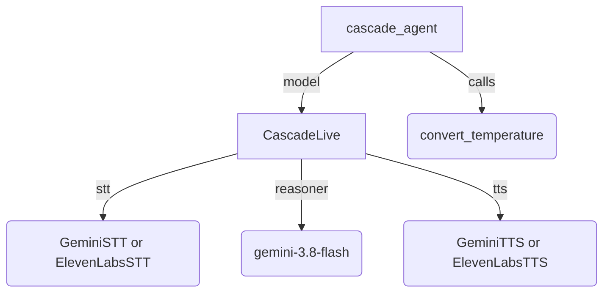

# Cascade Live Agent

## Overview

A voice agent built with `CascadeLive`: an STT transform turns the user's
speech into text, a Gemini text model answers and calls tools, and a TTS
transform speaks the answer. The agent spells random words out and converts
temperatures, and stops speaking when the user interrupts it. Tools and
instruction are the same as in text mode, while
callbacks, tool confirmation, and long-running tools follow live-mode
semantics, as with any other live model. The same agent definition still runs
under `run_async` with no live session at all.

The `CASCADE_SPEECH_PROVIDER` environment variable picks where the speech
transforms come from:

| `CASCADE_SPEECH_PROVIDER` | Speech to text                        | Text to speech                         | Setup                                        |
| ------------------------- | ------------------------------------- | -------------------------------------- | -------------------------------------------- |
| `gemini` (default)        | `GeminiSTT`, Gemini 3.5 Transcribe    | `GeminiTTS`, Gemini 3.8 Flash-Lite TTS | [README_gemini.md](README_gemini.md)         |
| `elevenlabs`              | `ElevenLabsSTT`, ElevenLabs Scribe v2 | `ElevenLabsTTS`, ElevenLabs Flash v2.5 | [README_elevenlabs.md](README_elevenlabs.md) |

## Setup

1. Set up the credentials of the provider you pick, as its README describes.
   The reasoner is a Gemini text model, so it needs Google credentials with
   either provider.

1. Pick the provider in a `.env` file in this directory, which `adk web` loads,
   or in your shell. Leave it unset for Gemini:

   ```sh
   CASCADE_SPEECH_PROVIDER=elevenlabs
   ```

## Run With Dev UI

From the directory that *contains* the `cascade` folder (`samples/live/`),
start the ADK web server:

```bash
adk web
```

Open the URL printed in the terminal, usually `http://localhost:8000`, pick
`cascade` from the dropdown in the top-left, then click the **Audio** icon next
to the chat input and speak. Captions of what you say appear while you speak.
Click **Audio** again to stop streaming. You can stop and restart the stream
any number of times within the same session.

## Sample Inputs

Say these out loud:

- `Spell five random words.`

  *The model picks five words and spells each one, letter by letter, in a
  single reply.*

- `Stop. Which words did you spell?`, said while the agent is still spelling.

  *The agent stops speaking at once and answers with only the words you heard
  before you interrupted.*

- `What is twenty-three degrees Celsius in Fahrenheit?`

  *The model calls `convert_temperature` and reads the result back.*

## Graph



## How To

Set a `CascadeLive` as the agent's `model`, with an STT and a TTS transform,
and keep the reasoner's thinking low:

```python
root_agent = Agent(
    model=CascadeLive(
        model='gemini-3.8-flash',
        stt=GeminiSTT(),  # Or ElevenLabsSTT().
        tts=GeminiTTS(speech_config='Kore'),  # Or ElevenLabsTTS().
    ),
    instruction='...',
    tools=[convert_temperature],
    generate_content_config=types.GenerateContentConfig(
        thinking_config=types.ThinkingConfig(
            thinking_level=types.ThinkingLevel.LOW
        ),
    ),
)
```

- **Thinking level**: thinking delays the first word of every reply, so the
  reasoner thinks at `LOW`, the lowest level Gemini 3.8 Flash supports.
- **Instruction**: both TTS transforms cut the reply at sentence ends, so the
  instruction asks for short sentences that end with punctuation; a sentence
  that never ends waits before it is spoken. It also asks for numbers, symbols,
  and abbreviations written as words, because the synthesizer reads the text
  as it is, and an abbreviation such as `Dr.` would end a sentence.

### Limitations

- **Turn detection relies on silence.** Both recognizers end the user's turn
  after a fixed period of silence, so a pause mid-sentence splits it into two
  turns, and the model answers each one. Each provider's README says how to
  tune the silence.
- **Don't speak while a tool is running.** If you finish speaking after the
  model calls a tool but before the tool returns, your words are added to the
  conversation before the tool's result. The model then gets the tool call and
  its result out of order, and this turn and all later turns in the session
  fail. Wait for the agent to answer before you speak again.
- **The agent can hear itself.** The recognizer hears whatever the microphone
  picks up, so without echo cancellation the agent's own voice from a speaker
  can count as the user speaking and interrupt the reply. Use headphones if
  that happens.
- **Responses are slower than with native audio models.** Each turn runs three
  steps in sequence (recognize, reason, synthesize), whereas a native
  speech-to-speech model runs one. The model also sees only the transcribed
  words, so it cannot perceive the user's tone, and the synthesized speech does
  not carry the model's intent beyond the words.

## Related Guides

- [CascadeLive](../../../../docs/guides/live/cascade_live/index.md) - How
  `CascadeLive` composes a text model with STT and TTS transforms.
- [GeminiSTT](../../../../docs/guides/live/gemini_stt/index.md) - Speech
  recognition with Gemini streaming transcription.
- [GeminiTTS](../../../../docs/guides/live/gemini_tts/index.md) - Speech
  synthesis with Gemini text-to-speech models.
