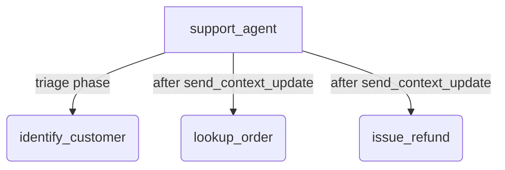

# ADK Live Context Update Sample

## Overview

A store-support agent whose instruction and tools change once during the
conversation. It starts in a triage phase with one tool, `identify_customer`.
When that tool returns, the application calls
`LiveRequestQueue.send_context_update()` to replace the system instruction
with the order-handling persona and the tools with `lookup_order` and
`issue_refund`, without reconnecting.

The sample also shows the other half of the pattern: a turn-specific policy
rule is appended to the conversation as a partial turn rather than sent as a
context update, because a context update rebuilds the model's prompt cache and
a tail-appended turn does not.

`agent.py` holds the agent and both phases' instruction and tools. `main.py`
drives a scripted three-turn conversation over `Runner.run_live()` and
performs the swap, because the application, not the agent, owns the
`LiveRequestQueue`.

Requires `google-genai >= 2.32.0` and a Vertex AI backend.

## Sample Inputs

Run the scripted conversation from the repository root:

```bash
python3 -m contributing.samples.live.context_update.main
```

The script sends these turns in order and prints what happens:

- `Hi, my number is 555-0100.`

  *The model calls `identify_customer`. On the tool result the script sends
  one context update: `[app] send_context_update: order-handling phase`.*

- `Where is order 42?`

  *The model now has `lookup_order`, calls it, and ADK executes it, which
  shows that tools swapped in mid-session are regular ADK tools.*

- `It arrived broken. Please refund it.`

  *Before this turn the script tail-injects a `[POLICY]` rule as a partial
  turn. The model reads the total back and asks for confirmation before it
  would call `issue_refund`.*

To try the triage phase interactively, run `adk web contributing/samples/live`
and pick `context_update`; the web UI does not send context updates, so the
agent stays in triage there.

## Graph



## How To

Decide the phase transition in the application's event loop and send one
update. `tools` takes ADK tools, and the update replaces the whole instruction
and the whole tool list:

```python
for response in event.get_function_responses():
  if response.name == 'identify_customer':
    live_request_queue.send_context_update(
        system_instruction=agent.ORDER_INSTRUCTION.format(
            customer=response.response
        ),
        tools=agent.ORDER_TOOLS,  # [FunctionTool(lookup_order), FunctionTool(issue_refund)]
    )
```

Send turn-specific context to the tail of the conversation instead. A partial
turn does not trigger a response and does not touch the instruction or tools:

```python
live_request_queue.send_content(
    types.Content(role='user', parts=[types.Part(text='[POLICY] ...')]),
    partial=True,
)
```

Key points:

- **One update per phase, not per turn.** The instruction and the tool
  declarations are the prefix of the prompt. The Live API caches that prefix
  across turns; every context update invalidates it, and the next model call
  re-processes the instruction, the tools, and the whole history.
- **Replacement semantics.** `system_instruction` overrides the instruction
  ADK assembled from the agent definition, and `tools` replaces every tool,
  including ADK's own `transfer_to_agent`. Pass `tools=[]` to clear them;
  leave an argument unset to keep its current value.
- **Scope.** The update is carried across reconnects of the current
  `run_live()` call. The next `run_live()` call starts from the agent
  definition again, so persist the phase in session state if it must survive.
- **Format the instruction yourself.** A context update takes a plain string;
  ADK's `{state_key}` templating applies to the agent's `instruction` only.

## Related Guides

- [LiveRequestQueue](../../../../docs/guides/live/live_request_queue/index.md) - The queue's methods, including `send_context_update()` and when to use it.
- [Live tools](../../../../docs/guides/live/tools/index.md) - How ADK executes tools during a live session.
- [Runner live](../../../../docs/guides/runners/runner/live.md) - Driving `run_live()` from an application.
