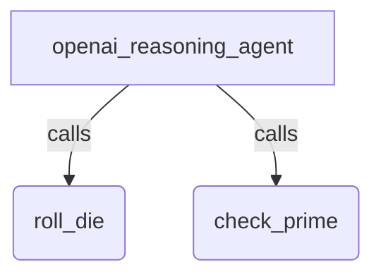

# OpenAI Responses API With a Reasoning Model

## Overview

A hello-world agent that runs on **gpt-6-astra**, an OpenAI reasoning model,
through the
[`OpenAIResponsesLlm`](../../../../src/google/adk/integrations/openai/README.md)
model. `OpenAIResponsesLlm` calls the OpenAI Responses API (`/v1/responses`).
LiteLLM is not involved.

The agent has the same two tools as `hello_world_openai`, `roll_die` and
`check_prime`, and it runs on a different API:

- **Tool calling needs the Responses API.** gpt-6-astra rejects function tools
  on Chat Completions (`/v1/chat/completions`) at every reasoning effort it
  accepts, so `OpenAILlm` cannot drive this agent. `OpenAIResponsesLlm` can.
- **Reasoning effort and summaries.** The agent sets a reasoning effort with
  `OpenAIGenerateContentConfig(effort="medium")`. This also asks the model for a
  concise summary of its reasoning, which ADK returns as thought parts
  (`part.thought=True`).

`OpenAIResponsesLlm` reads `OPENAI_API_KEY` from the environment (the openai
SDK's default client). To use a different reasoning model, set `OPENAI_MODEL`.

## Setup

1. Install the OpenAI extra from the repository root:

   ```bash
   uv sync --extra openai
   ```

1. Set your OpenAI API key (and optionally a model):

   ```bash
   export OPENAI_API_KEY="sk-..."
   export OPENAI_MODEL="gpt-6-astra"  # optional; defaults to gpt-6-astra
   ```

   Exporting the variables makes them available to both `run.py` and the Dev
   UI. The Dev UI (`adk web`) also loads a `.env` file from this
   directory, so you can put the variables there instead when you use it.
   `run.py` reads only the exported shell variables. Do not commit `.env`.

## Run the live test

`run.py` runs the agent against the real endpoint and checks text generation,
tool calling, multi-turn memory, and reasoning summaries. It prints a
`PASS`/`FAIL` summary and exits non-zero on failure. After each prompt it prints
how many reasoning tokens the model spent and how many reasoning summaries it
returned.

```bash
# Non-streaming
uv run --extra openai python contributing/samples/models/openai_responses_reasoning/run.py

# Streaming (StreamingMode.SSE)
uv run --extra openai python contributing/samples/models/openai_responses_reasoning/run.py --stream
```

Expected output ends with:

```text
=== RESULTS ===
  text_generation: PASS
  tool_call: PASS
  tool_response: PASS
  tool_final_text: PASS
  multi_turn: PASS
  reasoning_summary: PASS

OVERALL: PASS
```

## Run With Dev UI

The Dev UI discovers `agent.py` from the sample directory:

```bash
uv run --extra openai adk web contributing/samples/models/openai_responses_reasoning
```

Open the printed URL, select `openai_responses_reasoning`, and send one of the
sample inputs below.

## Sample Inputs

- `Roll a die with 20 sides and tell me whether it is prime.`

- `If I roll two six-sided dice, what is the probability that their sum is prime? Answer as a fraction.`

  *The model calls `check_prime` on the possible sums, then counts outcomes.
  That counting step makes it reason, so a reasoning summary appears before the
  answer.*

- `What number did I roll?`

  *Checks multi-turn memory after a roll.*

## Graph



## How To

- **Use the Responses API.** Pass an `OpenAIResponsesLlm` as the agent's
  model. It needs the optional `openai` package:

  ```python
  from google.adk.integrations.openai import OpenAIResponsesLlm

  model = OpenAIResponsesLlm(model=os.getenv("OPENAI_MODEL", "gpt-6-astra"))
  ```

- **Set the reasoning effort.** Put an `OpenAIGenerateContentConfig` on the
  agent. The standard `thinking_config` is not supported for OpenAI models.

  ```python
  root_agent = Agent(
      ...,
      generate_content_config=OpenAIGenerateContentConfig(effort="medium"),
  )
  ```

  The tiers a model accepts depend on the model and the API. gpt-6-astra
  accepts `low`, `medium`, `high`, `xhigh`, and `max` on the Responses API.
  On the default OpenAI host, ADK rejects an unsupported tier with a
  `ValueError` before it sends the request.

- **Read the reasoning.** Each reasoning summary arrives as a
  `types.Part` with `thought=True`. The number of reasoning tokens is in
  `event.usage_metadata.thoughts_token_count`. `run.py` reports both:

  ```python
  if part.text and part.thought:
    print(f"  [{event.author}/thought] {part.text[:120]}")
  ```

## Notes

- If no effort is set, the model still reasons, but ADK does not request a
  summary, so no thought parts come back. The model also skips reasoning on
  easy prompts, such as rolling a die, even with an effort set. A reasoning
  token count of 0 on those turns is expected.
- `OPENAI_MODEL` must name a reasoning model that accepts the configured
  effort. For a model that takes no reasoning effort, such as `gpt-4.1`, use
  `hello_world_openai` instead.

## Related Guides

- [OpenAI sample](../hello_world_openai/README.md) - The same agent on Chat
  Completions with `OpenAILlm`.
- [Azure Responses streaming sample](../azure_responses_streaming/README.md) -
  The Responses API on Azure OpenAI, with streamed function-call arguments.
- [LlmAgent](../../../../docs/guides/agents/llm_agent/index.md) - Configure an
  agent's model, tools, and `generate_content_config`.
