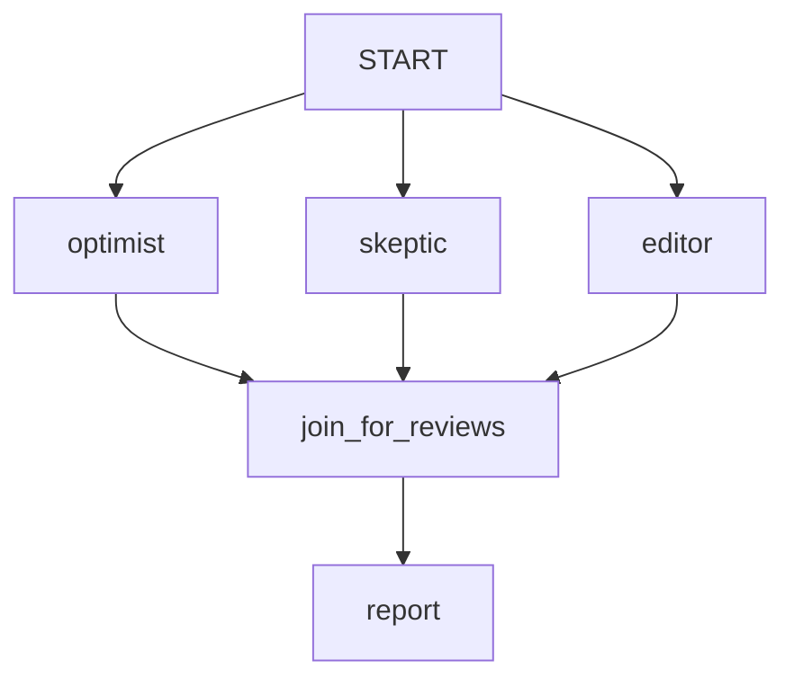

# Spend Budget Plugin

## Overview

`RunConfig.max_llm_calls` is one call counter for the whole run. A workflow
that fans out to many agents has to set it high enough for all of them, and
then one agent stuck in a tool loop can use most of it before the run stops,
taking the other agents' results down with it.

`SpendBudgetPlugin` caps spend in US dollars instead, at two levels:

- `run_usd`: the cap for one invocation (one `Runner.run_async` call).
- `agent_usd`: the cap for each agent run, with `agent_usd_overrides` by agent
  name. Every workflow node run has its own budget, keyed by its node path, so
  a fan-out of one agent definition gets one budget per node.

Before each model call the plugin reserves an estimate of its cost, and after
the call it books the cost of the response's `usage_metadata` in its place.
Because the estimate is held before the call is made, agents running in
parallel cannot together start more calls than the budget allows. When a call
does not fit, it is not made: the plugin returns an `LlmResponse` with error
code `SPEND_BUDGET_EXCEEDED`, which ends that agent's turn and names it, while
the rest of the run goes on. What an agent run does not spend goes back to the
run budget when the agent finishes.

The budgets come from [llm-agent-budget](https://github.com/Mattbusel/agent-budget)
(MIT, no dependencies), so install it first:

```bash
pip install -r contributing/samples/plugins/spend_budget/requirements.txt
```

## Sample Inputs

- `A weekly newsletter about local hiking trails`

  The optimist, skeptic and editor review the idea in parallel. Each one may
  spend at most $0.02 ($0.015 for the editor), and the run at most $0.10.

To see an agent being stopped without calling a model, run the scripted
demo. It fans out to three agents, one of which asks for a tool on every call:

```bash
python -m contributing.samples.plugins.spend_budget.main
```

```text
Without a spend budget (only RunConfig.max_llm_calls):
  looper: Max number of llm calls limit of `500` exceeded
  checker: 1 model calls, $0.0011
  looper: 498 model calls, $0.5478
  writer: 1 model calls, $0.0011
  run LlmCallsLimitExceededError: Max number of llm calls limit of `500` exceeded
With SpendBudgetPlugin(run_usd=0.10, agent_usd=0.02):
  looper: Agent 'looper' stopped: budget 'root_agent@1/looper@1' cannot hold $0.010240300: $0.010100000 left
  checker: 1 model calls, $0.0011
  looper: 9 model calls, $0.0099
  writer: 1 model calls, $0.0011
  run finished
```

## Graph



## How To

Register the plugin on the `App` with the prices of the model your agents use:

```python
app = App(
    name="spend_budget",
    root_agent=root_agent,
    plugins=[
        SpendBudgetPlugin(
            input_usd_per_million=0.30,
            output_usd_per_million=2.50,
            run_usd=0.10,
            agent_usd=0.02,
            agent_usd_overrides={"editor": 0.015},
        )
    ],
)
```

The estimate reserved before a call is the prompt's characters divided by four
as input tokens, plus `max_output_tokens` from the request's
`generate_content_config` (or `default_output_tokens`, 4096) as output tokens.
An agent whose cap is smaller than one estimate is never called, so set
`max_output_tokens` on agents with small caps. Thinking tokens are billed as
output. Override `cost_usd` for per-model or cached-token prices, and
`estimate_usd` for a different estimate.

An `AgentTool` sub-run is its own invocation, so it gets its own run budget, as
it gets its own `max_llm_calls` count today.

## Related Guides

- [App](../../../../docs/guides/apps/app/index.md) - Explains registering
  plugins on an app.
- [RunConfig](../../../../docs/guides/agents/run_config/index.md) - Explains
  `max_llm_calls`, the call limit this plugin complements.
- [Join Node](../../../../docs/guides/workflow/join_node/index.md) - Explains
  collecting the results of parallel nodes.
