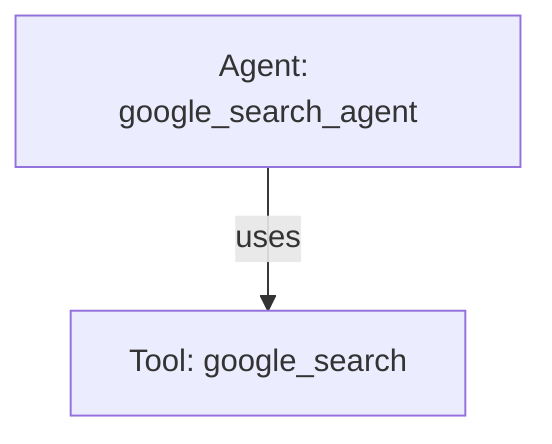

# Google Search Grounding Agent

## Overview

This sample demonstrates **native Google Search grounding** in Google ADK 2.0.

The agent uses ADK's built-in `google_search` tool (`from google.adk.tools import google_search`). Unlike local Python function tools, `google_search` is a server-side grounding tool executed directly by Gemini. The model autonomously decides when to issue web searches, synthesizes the results into its response, and attaches structured grounding metadata (search queries, source titles, and URIs) to the emitted ADK `Event`.

## Sample Inputs

- `What is the latest stable release of Python?`

  *The agent queries Google Search for recent release announcements and summarizes the latest version.*

- `What are the latest updates to Google Agent Development Kit?`

  *The agent searches for recent ADK documentation and releases, citing web sources.*

- `Explain the difference between Python 3.11 and 3.13 in two sentences.`

  *The agent utilizes search to confirm feature differences and provides a concise summary.*

## Graph



## How To

1. Import and register the built-in `google_search` tool in the agent's `tools` list:

```python
from google.adk import Agent
from google.adk.tools import google_search

root_agent = Agent(
    name="google_search_agent",
    description="Answers questions using native Google Search grounding.",
    instruction="Use Google Search when questions require current public information.",
    tools=[google_search],
)
```

2. Inspect grounding metadata and citations from the runner event stream:

```python
import asyncio
from google.adk.runners import InMemoryRunner
from google.genai import types

async def main() -> None:
    runner = InMemoryRunner(agent=root_agent)
    session = await runner.session_service.create_session(
        app_name="my_app", user_id="user_1"
    )

    message = types.Content(
        role="user",
        parts=[types.Part.from_text(text="What is the latest release of Python?")],
    )

    async for event in runner.run_async(
        user_id="user_1",
        session_id=session.id,
        new_message=message,
    ):
        if event.content and event.content.parts:
            for part in event.content.parts:
                if part.text:
                    print(part.text, end="", flush=True)

        if event.grounding_metadata:
            print("\n\n--- Web Search Queries ---")
            for query in event.grounding_metadata.web_search_queries or []:
                print(f"- {query}")

            print("\n--- Sources ---")
            for chunk in event.grounding_metadata.grounding_chunks or []:
                if chunk.web:
                    print(f"- {chunk.web.title or 'Untitled'}: {chunk.web.uri}")

if __name__ == "__main__":
    asyncio.run(main())
```

## Related Guides

- [Tools](../../../../docs/guides/tools/function_tool/index.md) - Explains registering tools with ADK agents.
- [LlmAgent](../../../../docs/guides/agents/llm_agent/index.md) - Explains configuring standalone agents in ADK 2.0.
