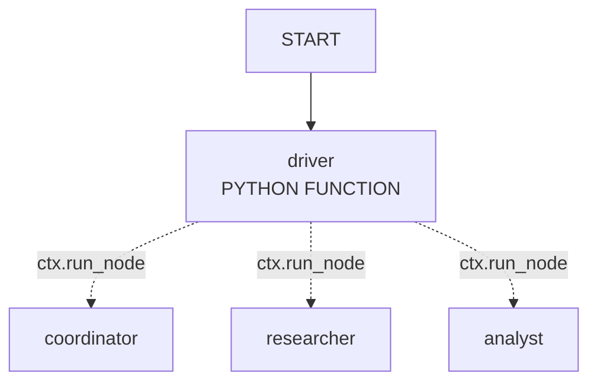

# ADK Adaptive Team Sample

## Overview

This sample coordinates two specialists from a shared plan. A coordinator
writes the plan, picks who should work next, and replaces the plan when two
rounds in a row do not move the task forward. The workflow stops with one
answer.

The helper is `adaptive_team` in `google.adk.labs.adaptive_team`. It is
experimental.

## Sample Inputs

- `Compare the energy use of electric and gas heating for a small apartment, and name the bigger uncertainty.`

  The researcher gathers facts. The analyst compares them. The coordinator
  answers after the progress check says the task is covered, or after the
  round and replan limits.

- `What would change that comparison if the apartment were heated only on weekends?`

  A follow-up in the same session starts a new plan. The previous ledger is
  left behind with the previous invocation.

## Graph



## How To

Build the workflow from a coordinator and the specialists. The coordinator's
instruction is extra guidance. The helper writes the planning, progress, and
final-answer instructions, and it does not call the coordinator's tools.

```python
root_agent = adaptive_team(
    name="energy_brief",
    manager=coordinator,
    participants=[researcher, analyst],
    max_rounds=6,
    stall_limit=2,
    replan_limit=1,
)
```

Set `review_plan=True` to pause for a yes or no on each plan. The reply is a
`PlanDecision`. Pass `approved` and, when rejecting, `notes` describing the
change. A rejection spends one entry from `replan_limit`.

Read the ledger from session state with `team_state_key("energy_brief")`.
Coordinator events set `custom_metadata["adaptive_team"]["kind"]` to `plan`,
`replan`, `progress`, or `answer`. Specialist events keep the specialist as
the author.

## Related Guides

- [adaptive_team](../../../../docs/guides/labs/adaptive_team/team/index.md) - Building a workflow that plans, selects specialists, and replans when work stalls.
- [Dynamic nodes](../../../../docs/guides/workflow/dynamic_nodes/index.md) - Running a node from inside another node with `ctx.run_node`.
- [Workflow](../../../../docs/guides/workflow/workflow/index.md) - The graph the helper returns.
