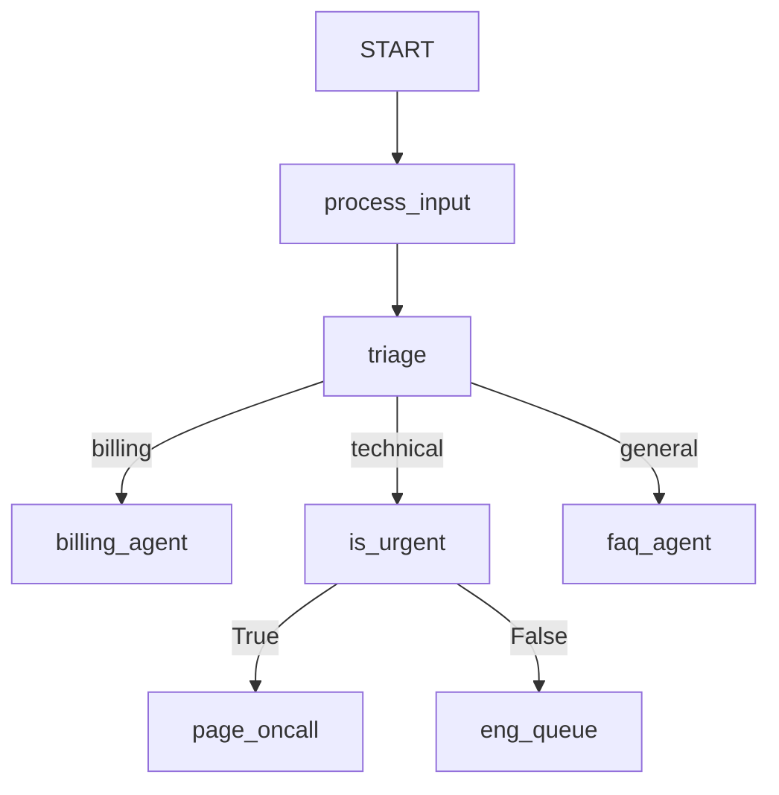

# ADK Workflow Classifier Routing Sample

## Overview

This sample demonstrates how to route an **ADK Workflow** with `ClassifierNode`.

It triages support tickets. A `ClassifierNode` asks a classifier which team should handle the ticket and routes to that team. Technical tickets go to a second `ClassifierNode` that asks whether the ticket is urgent, and either pages the on-call engineer or files it in the engineering queue.

A `ClassifierNode` asks one typed question about its input and emits the answer as the route:

- A `Choice` question routes to the chosen label.
- A `Binary` question routes to `True` when the probability is at or above `threshold`, otherwise to `False`.

The node's output is its unchanged input, so the next node receives the ticket. This sample uses `LlmClassifier`, which answers with any `BaseLlm`. Any other `BaseClassifier` can be swapped in without changing the graph.

## Sample Inputs

- `My invoice charged me twice this month.`

- `The checkout API returns 500 for every request and production is down.`

- `There is a typo on the pricing page.`

- `Do you have a dark mode?`

## Graph



## How To

1. Create a classifier and a `ClassifierNode` with a `Choice` or `Binary` question:

   ```python
   triage = ClassifierNode(
       name="triage",
       classifier=LlmClassifier(model="gemini-3.5-flash"),
       question=Choice(
           instructions="Which team should handle this support ticket?",
           criteria={"billing": "...", "technical": "...", "general": "..."},
       ),
       answer_key="triage_answer",
   )
   ```

1. Add a routing map with one edge per label, or a `DEFAULT_ROUTE` edge for the labels you don't list:

   ```python
   (triage, {"billing": billing_agent, "technical": is_urgent, "general": faq_agent})
   ```

   The workflow checks the routes when it is built. An edge for a label the question doesn't have, or a label with no edge, raises a `GraphValidationError`.

1. To read the probabilities in a later node, set `answer_key`. The full answer is stored in state under that key. In this sample, `page_oncall` reads `ctx.state["urgency_answer"]["probability"]`.
