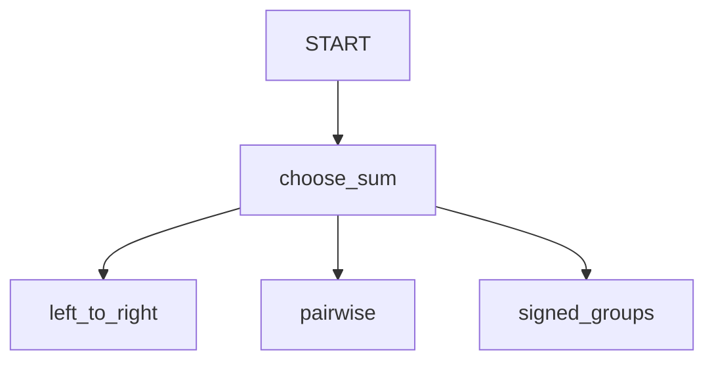

# Parallel tasks with a verified winner

## Overview

Three agents calculate the same sum using different instructions. The coordinator
accepts the first correct answer, cancels remaining work, and explicitly merges
only that answer into session state. A deterministic check rejects incorrect
answers even if they arrive first.

Arithmetic keeps the acceptance rule easy to inspect. A production application
should use its own verifier; asking a model to declare its own answer correct is
not independent verification. Computing a sum directly is cheaper than calling
three models when the sum itself is the only objective.

## Sample Inputs

- `17, 25, -4, 11`

- `100, -70, 20, -5`

## Graph



## How To

Run the sample with your configured ADK model:

```sh
uv run adk run contributing/samples/workflows/parallel_tasks
```

A function marked `@node(rerun_on_resume=True)` owns concurrent children:

```python
async with ctx.parallel_tasks(
    name="sum_candidates", max_parallel_workers=3
) as tasks:
  for solver in solvers:
    tasks.spawn(solver, node_input)
  winner = await tasks.first(accept=is_correct)
  await tasks.merge_result(winner, keys=["sum"])
```

`first` waits for an acceptable result and drains cancellation before returning.
The agents return proposals without writing an `output_key`; `merge_result`
checks that the selected state key has not changed since the group opened.

Cancellation stops cooperative local execution. Requests already sent to a
provider can still incur cost, and completed tool side effects are not undone.

## Related Guides

- [Parallel tasks](../../../../docs/guides/workflow/parallel_tasks/index.md) - Handles, messaging, progress, cancellation, and explicit result merging.
- [Parallel worker mode](../../../../docs/guides/workflow/parallel_worker/index.md) - Ordered fan-out over a list using the same task scheduler.
- [Dynamic nodes](../../../../docs/guides/workflow/dynamic_nodes/index.md) - Scheduling child nodes inside a coordinator.
