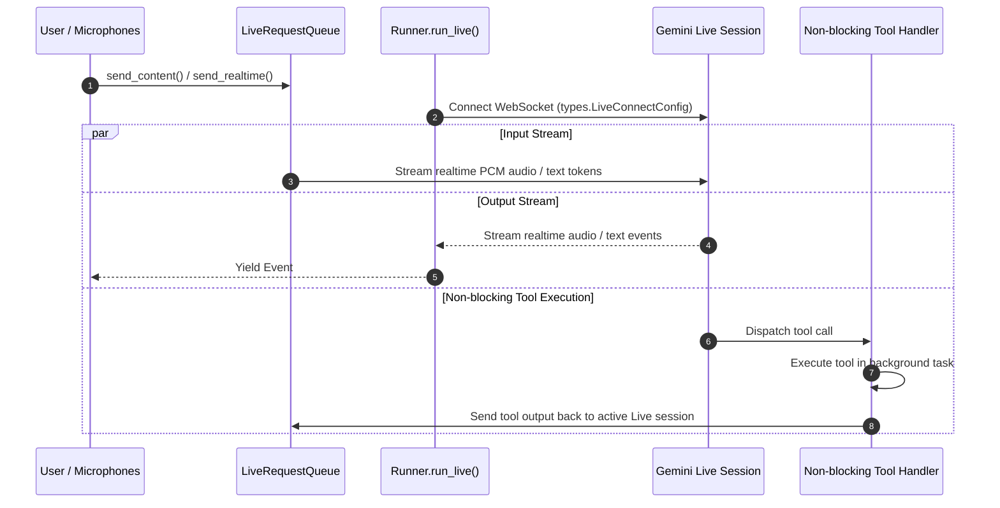

# Runner Live Streaming (run_live)

`Runner.run_live` is the real-time execution mode ADK uses to establish persistent bidirectional streaming sessions with Gemini Multimodal Live API models. It coordinates real-time audio/text streaming, `LiveRequestQueue` message ingestion, and non-blocking background tool execution.

## Introduction

Standard chat models operate via turn-based request-response cycles. For real-time voice, conversational audio, and streaming multimodal applications, waiting for complete turns introduces prohibitive latency. Gemini Live models require persistent, low-latency WebSocket or gRPC connections capable of receiving continuous PCM audio frames while simultaneously streaming back audio responses and executing tools.

The `run_live` subsystem resolves this by connecting `Runner` to Gemini Multimodal Live endpoints. Callers pass a [`LiveRequestQueue`](../../live/live_request_queue/index.md) to supply real-time user audio or text chunks. The runner maintains an active streaming session, routes non-blocking tool calls to background execution tasks without interrupting the audio stream, and yields real-time model content events (`Event`).

## Get started

Attach an `LlmAgent` to an `App`, connect it to an `InMemoryRunner`, create a session, and drive a live session using `LiveRequestQueue`:

```python
from google.adk.agents import LlmAgent
from google.adk.apps import App
from google.adk.live import LiveRequestQueue
from google.adk.runners import InMemoryRunner
from google.genai import types

root_agent = LlmAgent(
    name="voice_agent",
    instruction="You are a voice assistant. Answer queries concisely in spoken English.",
)

app = App(name="voice_app", root_agent=root_agent)
runner = InMemoryRunner(app=app)
queue = LiveRequestQueue()

# In an async task:
# 1. Create the session that the live conversation runs in
session = await runner.session_service.create_session(
    app_name=app.name,
    user_id="user_123",
    session_id="session_live",
)

# 2. Push user text or audio into the queue
queue.send_content(
    content=types.Content(
        role="user",
        parts=[types.Part.from_text(text="Hello! Can you hear me?")],
    )
)

async for event in runner.run_live(
    user_id="user_123",
    session_id=session.id,
    live_request_queue=queue,
):
  if event.content and event.content.parts:
    for part in event.content.parts:
      if part.text:
        print("Live model response:", part.text)
```

The queue allows callers to push PCM audio frames or text messages into the active session asynchronously while `run_live` streams response events back.

`run_live` looks the session up the same way `run_async` does, so the session has to exist before you call it. If it does not exist, `run_live` raises `SessionNotFoundError`. A `Runner` built with `auto_create_session=True` creates the session for you instead, but `InMemoryRunner` does not accept that argument, which is why the example creates the session first.

The `async for` loop does not end when the model finishes a reply, because a live session stays open until you close it. Call `queue.close()` when the conversation is over. Closing the queue closes the connection to the model, and the loop then ends.

## How it works

The live execution lifecycle coordinates between `Runner`, `LiveRequestQueue`, `BaseLlmFlow`, and the Gemini Live API backend:



1. **Connection Setup:** `run_live` establishes a persistent bidirectional connection using `types.LiveConnectConfig` (specifying modalities like `AUDIO` or `TEXT` and voice settings).
2. **Asynchronous Input Ingestion:** `LiveRequestQueue` wraps an `asyncio.Queue[LiveRequest]`. The caller streams audio PCM chunks (`queue.send_realtime()`) or text tokens (`queue.send_content()`), which `run_live` forwards over the open WebSocket.
3. **Event Categorization & Session Filtering:**
   * **Inline Audio Events (`inline_data`):** Streamed directly to callers for low-latency audio playback, but **not** saved to session history to prevent session bloat.
   * **Artifact Media Events (`save_live_blob`):** Video and audio data are saved to artifact storage and persisted to session history when `save_live_blob` is set to `True` on `RunConfig`.
   * **Transcriptions & Tool Calls:** Non-partial transcriptions, usage metadata, and function calls are always saved to session history.
4. **Non-Blocking Background Tools:** Streaming tools, which are async generator functions, and tools declared non-blocking run as background tasks, so audio output is not blocked while they work. The [Live background tools](../../live/tools/index.md) guide explains how to declare a tool non-blocking. Once complete, tool execution results are pushed back into `LiveRequestQueue` to update the model.

## Configuration options

`run_live` accepts the following configuration parameters:

| Parameter | Type | Default | Description |
| :--- | :--- | :--- | :--- |
| `user_id` | `str \| None` | `None` | User ID for the session. Required if `session` is `None`. |
| `session_id` | `str \| None` | `None` | Session ID for the session. Required if `session` is `None`. |
| `live_request_queue` | `LiveRequestQueue` | *(required)* | Queue used to push real-time user inputs, audio chunks, and tool results into the session. |
| `run_config` | `RunConfig \| None` | `None` | Execution configuration including `speech_config`, `response_modalities`, and `save_live_blob`. |
| `session` | `Session \| None` | `None` | Pre-fetched session instance (deprecated in favor of `user_id` and `session_id`). |

### RunConfig Live Options

Configured via `run_config=RunConfig(...)`; see [RunConfig](../../agents/run_config/index.md) for all live audio, transcription, VAD, and thread-pool options:

| Option | Type | Default | Description |
| :--- | :--- | :--- | :--- |
| `speech_config` | `types.SpeechConfig \| None` | `None` | Voice selection and audio encoding configuration for live agents. |
| `response_modalities` | `list[types.Modality] \| None` | `None` | Output modalities returned by the model (`AUDIO` or `TEXT`). |
| `save_live_blob` | `bool` | `False` | Saves live video and audio data to session and artifact service. |
| `session_resumption` | `types.SessionResumptionConfig \| None` | `None` | Configures transparent session resumption mechanism. |
| `tool_thread_pool_config` | `ToolThreadPoolConfig \| None` | `None` | Runs tools in a background thread pool executor to keep event loop responsive. |

If you leave `response_modalities` unset, the model responds with audio. Some native-audio models reject a request that names no modality, so `run_live` runs with a copy of your `RunConfig` that sets `response_modalities` to `[types.Modality.AUDIO]`. The `RunConfig` you passed in is not changed. Pass `[types.Modality.TEXT]` if you want text responses.

## Advanced applications

### Non-blocking streaming tool callback

A tool written as an async generator function is a streaming tool. ADK starts it as a background task, and each value the tool yields is sent to the model as a function response while the tool keeps running. The following tool reports that a lookup has started before it returns the price:

```python
async def fetch_stock_ticker(symbol: str):
  """Fetches live stock price while streaming progress."""
  # Tell the model that the lookup is underway
  yield {"symbol": symbol, "status": f"Fetching latest price for {symbol}"}
  # Perform lookup
  yield {"symbol": symbol, "price": 154.25}
```

A streaming tool can also declare a parameter named `input_stream` with the type `LiveRequestQueue`. ADK then gives the tool a queue of its own and copies every request from the session's queue into it, which lets the tool watch the user's audio or video while the conversation continues. ADK leaves `input_stream` out of the function declaration the model sees, so the model never tries to fill it in.

## Limitations

*   **Gemini Live Model Requirement:** `run_live` requires model endpoints that support the Gemini Multimodal Live API. An `LlmAgent` with no `model` set uses `LlmAgent.DEFAULT_LIVE_MODEL` (`gemini-live-2.5-flash-native-audio`) in live mode.
*   **Inline Audio Persistence:** Raw PCM audio blobs (`inline_data`) are intentionally omitted from session storage. To retain session audio and video history, set `save_live_blob=True` on `RunConfig`.
*   **Experimental API:** `run_live` is marked experimental, and its API or behavior may change in future releases.

## Related guides & samples

*   [Runner and InMemoryRunner](index.md) — Main guide on standard turn-based runner execution.
*   [LiveRequestQueue](../../live/live_request_queue/index.md) — Guide on real-time input queueing, audio chunking, and non-blocking streaming tools.
*   [App Container](../../apps/app/index.md) — Guide on bundling agents and plugins into an `App`.
*   [Live Bidi Streaming Single Agent](../../../../contributing/samples/live/single_agent/agent.py) — Sample single-agent real-time streaming application.
*   [Live Non-Blocking Tool Agent](../../../../contributing/samples/live/non_blocking_tool_agent/agent.py) is a sample agent whose slow tool is set to `FunctionResponseScheduling.WHEN_IDLE`, so the agent keeps talking with the user while the tool runs.
*   [Live Bidi Streaming Tools Agent](../../../../contributing/samples/live/tools_agent/agent.py) is a sample with streaming tools, including one that takes `input_stream: LiveRequestQueue` to monitor a video stream.
